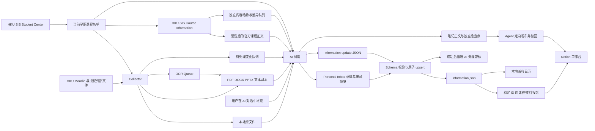
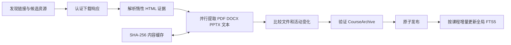

# HIQS 架构与数据流

HIQS 的产品主体是 `skills/` 中的 AI Skill Set。Skills 负责意图解析、来源理解、
任务编排和内容写作；Notion 是主要可视化与资料展示端；Python 只提供这些工作流共用的
确定性服务。服务通过 `HIQSPort` 暴露，MCP 是 Agent 调用服务的正式适配器。

## 产品结构与职责

```text
skills/                          产品 Skills 的唯一源，独立打包分发
├── hiqs-course-information/      事实审阅、证据问答与受控更新
├── hiqs-course-notes/            完整阅读、教学写作与分批交付
├── hiqs-course-planning/         选课组合、时间表、授权内自动 enrolment
└── hiqs-notion-workspace/        展示、发布、视图与交付核验
src/hsas/                        Python 复用服务，保留现有包名和运行数据兼容
contracts/                       服务合同快照
.agents/skills/                  产品 Skill 相对链接及仓库工程 Skill
```

工程 Skill 保留在 `.agents/skills/hiqs-product-development`，不进入产品 Skill 包。
旧 `src/AI_Skills` 指向 `skills/hiqs-course-information`，供已复制的旧提示词继续使用。
迁移移动整个 Skill 目录，保留 references 和 agents 元数据；只有 `skills/` 中的文件
是产品 Skill 的维护源。Python 不导入或执行 Skill Markdown。

| 所属层 | 拥有的职责 | 修改位置 |
| --- | --- | --- |
| AI Skills | 选择任务路径、解释证据、组织课程事实、教学推导与正文、决定何时交付 | `skills/<skill>/` |
| Python 复用服务 | 机构采集、文本/OCR、检索、验证、原子保存、版本检查、稳定 ID 投影与上传 | `src/hsas/` |
| Notion | 课程/课程档案/资料展示、笔记页面与用户正文 | 已验证的工作台与数据源 |
| MCP／CLI | 将调用转交同一 `HIQSPort`，CLI 同时承载设置、恢复和确定性 worker | `src/hsas/mcp`、`src/hsas/cli` |

新增需求先判断是 Agent 的理解/编排/写作，还是可跨 Skills 复用的确定性能力。
前者进入 Skill，后者进入现有 service；MCP 和 CLI 仅增加必要入口，避免增加透传服务层。
后台 worker 只采集、上传和同步投影，不运行 Agent、不自动抽取或批准新课程事实。
现有 Python 用例编排负责事务、取消和重试等机械执行；学习流程及内容判断留在 Skills。

## 主链路



职责边界：

- Student Center Collector：读取当前学期注册课程名单，保存原始可读文本、课程代码和独立审阅 checkpoint；
- Collector：按注册课程发现 Moodle 活动、下载文件、记录来源与失败；
- SIS Course Information Collector：从 Student Center 课程代码查询官方课程页，清洗页面并保存可读副本、来源和内容哈希；
- AI：阅读原文件或文本副本，识别课程、tutorial、DDL、课业要求、形式和占分；
- Information Service：检查类型、范围、唯一 ID、课程引用与时间关系，原子写入；
- Change Queue：区分首次全量与后续增量，提供精确文件路径并记录处理游标；
- OCR Queue：识别扫描 PDF 与图片型 PPT，调用本地 OCR 并更新可搜索 sidecar；
- Personal Inbox：暂存用户通过 AI 补充的课程信息，并在逐字段预览与确认后进入统一校验；
- Notion：主要展示端，使用同一事实投影与资料身份，个人状态和正文由学生管理；
- Calendar：确定性展开重复时间，供 Apple、ICS 和本地兼容客户端复用；
- 用户：授权资料范围，并可通过 AI 对话确认额外事实或更正。

## Python 复用服务与调用入口

产品调用路径为 `Skill → MCP → HIQSPort → 复用服务`；事实和资料通过确定性
Notion adapter 交付，笔记正文通过 Agent 的 Notion 连接器发布。两者分别核验结果。

| 能力 | 现有复用实现 |
| --- | --- |
| 机构来源与采集控制 | `core/services/sources.py`、`core/sync/`、`infrastructure/{moodle,sis,class_planner}/` |
| 原文件、全文清单与带引用检索 | `core/services/materials.py`、`application/material_search.py` |
| PDF/Office/OCR | `infrastructure/documents/`、`core/services/runtime.py` |
| 事实合同、校验、写入与审阅游标 | `core/services/{information,records,reviews}.py` |
| 笔记来源、revision 检查点与导出 | `core/services/course_notes.py`、`application/course_notes.py` |
| Notion 只读投影、原文件与稳定 ID 同步 | `core/services/notion.py`、`application/notion_projection.py`、`infrastructure/notion/` |
| Notion 按钮请求与采集进度 | `core/services/notion_controls.py`、`application/notion_controls.py` |

这些实现保留现有分层与 import 路径，不为改目录额外包一层透传服务。

课程笔记走独立链路：`hiqs-course-notes` 编排 Agent 阅读和教学写作，
`CourseNotesPort` → `CourseNotesService` 在私有 resources 的 `course-notes/`
保存输入哈希、来源审阅、单元计划、题目关联、正文及发布回执。检查点是原子 JSON；
每个 revision 的 Markdown bundle 是可重建的交付投影，保存后读回核验。
版本校验及进程文件锁拒绝旧状态覆盖；用户编辑的当前导出必须读回合并后才能继续保存。
该链路不写 `information.json`，不推进课程事实审阅游标，也不创建后台生成服务。
结构完成、Agent 的来源阅读声明、教学质量、学生掌握及外部发布分别报告。
接口及验收边界见 [课程笔记实现说明](docs/course-notes-implementation.md)。

Notion delivery 也通过 `HIQSPort`：`NotionDeliveryService` 从已校验的
Information Store 与受限资料解析器构建课程库只读投影；REST adapter 发布课程、
课程档案属性与哈希去重的原文件。默认不向 Notion 投影待办或日历；它们由
独立 Apple 同步服务管理。CSV/Markdown/ZIP 和
Notion connector adapter 使用同一投影。个人执行状态与正文归 Notion
所有，同步不反向写入 canonical facts。连接凭据、派生检查点和后台日志
只位于私有 resources/notion；多个进程通过独立文件锁避免重复写入。

```text
src/hsas/
├── core/             稳定 Port、façade、服务容器与同步编排
├── mcp/              面向 AI 的 MCP tools
├── domain/           CORE 内部纯模型与规则
├── application/      CORE 内部用例
├── infrastructure/   CORE 内部来源、存储和运行时适配器
├── cli/              Typer CLI 入口与命令组
└── codegen/          JSON Schema 衍生代码生成器
```

`HIQSPort` 是 CORE 对外的聚合契约，由按用例划分的能力接口组成：

- `InformationQueryPort`：信息、材料、证据与日历的只读查询；
- `InformationCommandPort`：经验证和明确确认的信息变更；
- `CourseSyncPort`：HKU 来源认证、同步与后台任务控制；
- `ApplicationLifecyclePort`：固定 commit 的本地应用更新。
- `CourseNotesPort`：整套学习笔记的输入清单、完整正文读取、检查点和本地交付。
- `NotionDeliveryPort`：连接检查、稳定投影、原文件同步、导出与同步控件状态。

MCP 接受注入的 Port，不导入 domain、application、infrastructure 或彼此的实现：

```text
domain ← application ← infrastructure/composition ← CORE implements HIQSPort
                                                    ↑
                                                   MCP
```

领域层保持纯模型与规则。内部应用用例通过 repository/gateway ports 使用外部系统，
基础设施提供实现；这些内部对象不会穿过 `HIQSPort`。后台同步线程、取消信号与状态快照
由独立的 `CourseSyncController` 管理，`CourseSyncWorkflow` 负责认证、并发来源采集、进度、
取消、精确重试和结果持久化。`InformationSnapshotService` 组合规范事实与各来源状态，生成
只读信息快照；`CourseRecordService`、`SourceReviewService`、`PersonalInboxService` 与
`MaterialQueryService` 分别负责规范记录变更、来源审阅游标、个人草稿和只读材料证据。它们
使用注入的 repository，并由 `HIQSCore` 组合。应用更新与本地证据操作分别由
`ApplicationLifecycleService`、`LocalEvidenceOperationService` 负责；同步来源命令由
`InstitutionalSourceService` 负责，具体 gateway 在 `source_factories.py` 组合边界创建。
CORE façade 只维持稳定 Port、服务装配和兼容入口。MCP 是 Agent 的正式接口；CLI 是人工
诊断、恢复和无 MCP 环境使用的薄适配器。CLI 不得重复实现校验、写入、报告或 checkpoint
业务逻辑，仍需终端交互回调的 collector 命令仅保留界面适配。新增服务工具进入 `mcp`；
新的展示工作流优先进入 Notion。

MCP 工具按工作流分区。完整面（`full`）服务人工排查；`course-information`、
`course-notes`、`course-planning`、`notion-workspace` 四个 profile 只暴露对应 Skill
使用的工具，由 `HIQS_MCP_PROFILE` 或 `hiqs-mcp --profile` 选择。登录、原生权限、
取消与导出这类需要人在场的 operator 工具不进入任何 Skill profile。分区与工具清单由
`contracts/mcp-tool-profiles.json` 固定：新增工具未归入任何位置时检查失败。

“需要确认”使用同一条只读链路：只读快照进入 application 层的确定性 attention
用例，生成 reason code、证据、缺失字段、严重程度、指纹与允许动作，再由
`InformationQueryPort.attention_snapshot()` 暴露给 MCP。当前时间由 CORE 注入，
以便测试固定 14 天窗口；调用方不重新判断风险。暂时忽略只写浏览器偏好，指纹变化后
自动重新出现，绝不修改 `information.json`。来源未覆盖不会产生冲突；只有既有 warning 明确记录的矛盾才生成
`SOURCE_CONFLICT`。

## Moodle Collector

一次同步在 staging 目录内完成，成功后才替换上一份课程快照：



采集实现拆成可独立测试、可注入的发现、下载、解析三阶段。下载阶段接受 Moodle
`pluginfile.php` 附件及各类文件响应，并通过响应类型与来源规则确认文件；解析阶段只处理
已取得的惰性 HTML，不执行脚本，并以 Trafilatura 作为正文提取 fallback。文件受最大大小、
超时和并发配置约束。原始字节仅写入本地存储。

对 URL、Page、Label 和其他 HTML 活动，下载器会从活动页开始做有界递归采集：跟随同源
Moodle 内容页、`pluginfile.php` 及文档链接，并解析中间 HTML 页的正文作为 Agent 证据。
默认最多 6 层、100 个中间页面和 200 个文件（可由 `MOODLE_MAX_LINK_DEPTH`、
`MOODLE_MAX_LINKED_PAGES`、`MOODLE_MAX_LINKED_FILES` 或 TOML 配置覆盖）。同一 URL 只
访问一次，Moodle 导航页、外部普通链接和超出预算的分支不会继续爬取；若触及上限，活动
会标记 `collection_report.truncated` 并在正式证据模型中保留实际限制，避免 Agent 把不完整
结果误认为完整清单。

Google Workspace 链接是受控例外：`docs.google.com/document`、`presentation` 和
`spreadsheets` 链接分别尝试导出 DOCX、PPTX、XLSX。若导出返回登录页或权限页，活动
标为 external，并记录原因。

条件请求使用 ETag 和 Last-Modified；内容一致时复用原路径。失败同步期间继续使用上一份
有效课程目录。

## AI 可读资料

每个 `StoredFile` 保存：

- 原文件名、本地相对路径与已清理的来源 URL；
- MIME type、字节数、SHA-256、下载和校验时间；
- 若可提取，保存 extraction method、状态、文字量、警告和文本副本路径。

文本副本位于课程目录的 `analysis/text/`：

- PDF 使用 `--- Page N ---`；
- PPTX 使用 `--- Slide N ---` 并附 speaker notes；
- DOCX 包含正文及可见的页眉、页脚、脚注、尾注和批注文本。

Moodle 页面自身的 Text and media area、活动说明等可见正文保存在对应 activity 的
`content_text`。HTML 表格不保存为可执行页面，而是转换为 `content_tables` 的
caption/row/cell 结构，保留空单元格、表头及 rowspan/colspan。递归页面保存在
`linked_pages`，范围与截断信息保存在 `collection_report`。旧 archive 中对应的 metadata
字段只在模型载入时迁移，业务代码不再读取这些兼容键。正文或表格变化也会生成增量审阅记录。

每个活动可确定性投影为 `EvidenceNode` / `EvidenceEdge` 图：活动、嵌套 HTML 页面、原文件与
提取文本各有稳定 evidence ID，并用 `links_to`、`contains`、`derived_from` 连接。MCP
`get_evidence` 返回节点、相邻节点和完整性状态，Agent
可以从搜索命中追溯到原始来源，而不需要理解存储实现。搜索包受字符预算约束；需要完整上下文
时，MCP `get_evidence_content` 按 evidence ID、chunk index 和最多三个相邻 chunk 定向展开，
避免把无关文件一并送入 Agent。

`explain_evidence` 统一返回确认状态、
来源、处理方式、警告和已知限制。正式记录使用 `information:course:<course_id>` 与
`information:item:<item_id>` 作为稳定 evidence ID。

`hsas materials list` 输出所有原文件和文本副本的绝对路径，方便 AI 直接读取；
`hsas materials search` 对已有文本副本作本地检索。原文件始终保留，AI 可按格式使用相应
文档工具读取各类资料。

同步发布课程快照后会按课程增量更新本地 SQLite FTS5 全局索引。索引同时包含 Moodle 活动、
提取文件与 `information.json` 正式记录。每份文档以 evidence ID 和
内容指纹登记；只删除、重建已变化或已移除的证据行，未变化行保持原 rowid。课程过滤仅发生
在 SQL 查询，不生成课程专属索引，也不扫描文件树。旧版或损坏索引只在首次读取时完整重建。
活动、嵌套页面及提取文本的搜索命中直接携带对应证据图节点 ID，同时返回课程、活动、文件、
页码和文本副本路径。结构感知分块先保留 page/slide 边界，再按标题层级切分；表格按行建立
独立块并保留原始表对象。索引是可删除的派生缓存，不会改变 canonical `course.json` 或个人资料。

PDF、DOCX 与 PPTX 分析使用有界工作池，并将结果按“来源 SHA-256 + parser version”写入
`cache/document-analysis/`。相同内容跨课程、改名或重复同步时直接复用已验证文本和分析模型；
parser version 变化会自然产生新缓存键。OCR 改写文本后只刷新受影响课程的索引。

HKU SIS 课程页面保存在 `sis-course-info/courses/<COURSE_CODE>/latest.txt` 与
`latest.html`。采集器只截取可见课程正文、移除 PeopleSoft 导航和会话状态，并记录安全的
Subject/Catalogue URL 与 SHA-256。课程事实保持由 AI 阅读，页面结构差异不会进入固定事实
parser。当前学期课程名单保存在 `sis-enrollment/latest.json`，Student Center 可见正文
保存在 `sis-enrollment/latest.txt`；课程名单的变化使用独立 batch 与 checkpoint 交给 AI
审阅。相同课程的多个 Moodle section 共用一份 SIS 来源。Class Planner 与 SIS 访问器
共享持久化 HKU Portal browser profile。统一同步完成一次 Portal 登录后，Moodle 直接访问
`/login/index.php?authCAS=CAS` 建立 Moodle 会话，SIS 则优先打开目标页面复用 Portal 会话；
只有会话过期或 SIS 仍要求验证时，才保留可见窗口供用户处理。随后由
application 层的 `UnifiedCourseSyncService` 编排来源任务。infrastructure 层的
`BrowserSessionBroker` 在整个采集阶段只打开一个 headless Chromium context，Moodle、SIS
Course Information 和 Class Planner 各自使用独立 page 并通过 `asyncio.gather` 并发运行。
Class Planner 属于认证完成后的 SIS 课表采集阶段，不再承担 Portal 登录入口。共享浏览器状态
以 0600 权限保存，显式恢复 session-only Cookie，避免不同采集上下文再次要求 Portal 登录。
来源分别写入自己的目录，聚合状态只在锁内更新。

提取器会把文字覆盖不足的扫描 PDF 和图片型 PPT 标为 `ocr_required`。`hsas ocr status`
读取这些分析记录生成队列，`hsas ocr run --confirmed` 使用本地 Apple Vision 或
Tesseract/Poppler 批量识别。识别结果追加到文本副本并重新计算哈希、摘要、关键词和阅读
时间，随后原子更新对应 `course.json`。

## Incremental AI Review

每次成功同步都会比较上一份快照，并把活动、Moodle 日期和课件的新增、修改或删除写入
`courses/<course_id>/changes/history/`。课件变化携带原文件、文本副本和来源 URL；历史记录
随课程快照事务保留。

`ai-state/change-checkpoint.json` 为每门课程保存 AI 已处理到的 `collected_at`。课程等待
首个游标时，`changes show` 生成 `full` review；已有游标时则汇总之后的 change sets。输出批次
携带 `acknowledge_through`，因此生成批次后发生的新同步会使旧批次失效。

```text
MCP get_pending_changes → Agent 阅读 evidence → apply_information_update → recent_update + checkpoint
```

checkpoint 在信息写入成功后推进。信息已保存而游标确认失败时，变化保持 pending 以支持
安全重试。审查确认课程事实保持一致时，使用带双重确认的独立 acknowledge。

每次正式写入同时生成 `ai-state/recent-information-update.json` 的整理摘要。摘要先由已验证的
差异和证据节点提供安全 fallback；Agent 读取 `apply_information_update` 返回的报告后，可通过
MCP `save_recent_update_summary` 提交一段自己的总述和最多六个重点。CORE 只接受属于最新报告
的课程、事项和来源引用，避免摘要脱离证据。首页优先显示摘要，完整字段差异仍通过明细入口
查看。旧版没有摘要字段的报告继续按原结构读取，不会阻断日历或资料展示。

HKU SIS 页面使用 `sis-course-info/history/` 和 `review-checkpoint.json` 维护独立增量队列。
AI 先阅读变更记录指向的 `text_relative_path`，并以 `source_type: sis_course_info` 引用来源。
Moodle 当前页面、活动元数据、公告与课程资料拥有最高优先级；SIS 和 Class Planner 补充
Moodle 未陈述的事实。来源冲突时采用 Moodle 支持的值，同时保留双方证据与警告。

## Information Store

`information.json` 是日历的唯一事实输入：

```text
InformationStore
├── schema_version
├── timezone
├── updated_at / updated_by
├── courses[]
│   ├── course_id / moodle_course_id / code / title / color
│   ├── semester / starts_on / ends_on / overview / objectives
│   ├── instructors / links
│   └── policies / notes / sources
└── items[]
    ├── item_id / course_id / title / category
    ├── date_status
    ├── opens_at / starts_at / ends_at / due_at / due_on / scheduled_on
    ├── recurrence
    ├── location / description
    ├── assessment_format / submission_method
    ├── weight_percent / word_limit
    └── requirements / policies / warnings / links / materials / sources
```

类别覆盖课程、tutorial、lab、office hour、assignment、quiz、exam、presentation、
project、report、reading、deadline 和 other。

重复规则使用 Monday=0 到 Sunday=6，并带有效起止日期、开始/结束时间、排除日期和补课
日期。确认状态的事项必须有日期或重复规则；结束时间必须晚于开始时间；占分必须在 0–100。

## Upsert 事务

`InformationUpdate` 是 AI 写入格式。应用服务执行：

1. 要求显式 `--confirmed`；
2. 验证 update；
3. 读取并验证当前 store；
4. 按稳定 `course_id` 和 `item_id` 合并完整记录；
5. 验证合并结果中所有 item 都指向已存在课程；
6. fsync 临时文件后用 `os.replace` 原子替换。

省略记录会保留，删除使用显式流程。任何失败都发生在替换前。

## Personal Inbox

`ai-state/personal-inbox.json` 保存 AI 根据用户明确陈述准备的 `InformationUpdate` 草稿。
每条草稿拥有稳定 ID、创建时间、备注和 pending/applied 状态。`hsas inbox list`
将草稿同当前 `information.json` 比较，呈现 create/update 动作以及
逐字段 before/after。用户确认单条草稿后，应用服务调用现有 Information upsert，再把
Inbox 条目标为 applied。

## Apple 交付与本地更新

Apple Calendar/Reminders 是独立的确定性 delivery 路径，经同一 `HIQSPort` 将已校验
事项单向同步到用户选择的 Apple 账户。原生 EventKit helper 保留个人完成状态、提醒
铃声和个人备注，按稳定 identity 对账，并逐条读回。LaunchAgent 监听 canonical
information 文件并周期性重试，不运行 AI、不批准事实；Apple 本地回执不代表 iCloud
另一设备已收到。架构、账户边界及恢复详见 [Apple 整合](docs/apple-integration.md)。

Notion 配置和真实同步的状态边界见 [Notion 整合说明](docs/notion-integration.md)。

本地安装通过固定的 GitHub raw version URL 只读比较版本。自动更新仅对官方
`origin` 的 Git 源码安装开放，并要求工作树干净、当前 HEAD 是 `origin/main` 的祖先；随后
使用 `git merge --ff-only`，仅在依赖文件变化时更新 `.venv` 与 Playwright。用户课程资料
位于 Application Support，不参与源码更新。

## 有限兼容

旧 CLI 名称 `hsas` 和默认数据目录 `HSAS` 保留，以继续访问用户已经下载的资料。
读取旧 `course.json` 时会忽略历史 `assessments` 字段；Planner、Student Profile、
Execution Log、Assessment Parser 及其命令均已从代码库移除。

## 课程规划与 enrolment 任务

`skills/hiqs-course-planning` 编排 syllabus／SIS 阅读、候选推荐与真实页面操作；
`CoursePlanningPort` → `CoursePlanningService` 使用 application 层的日期／组件约束求解器，
在私有 `course-planning/<run_id>/state.json` 保存目标、已认可候选池、计划版本、授权、
官方状态观察、成功锁定集合和逐项尝试。执行状态不进入 `information.json`。
MCP 与 CLI 仅委托同一 Port；当前不增加兼容 UI 页面。

`next_course_plan_action` 在进程文件锁及 revision 检查下，先原子保存一笔 unknown 尝试，
再返回一次性 submit 指令。Agent 在官方页面执行一次 add/enrol，读回完整账户、学期、
组件与原始状态，再调用 reconcile；恢复时未对账的尝试阻止重投，Pending／候补单独保存。
成功课程保持固定，其他目标重新整体求解。同账户／学期的本地任务共享提交互斥，
外部浏览器仍须操作前即时核验。真实状态由 Agent 提交证据，服务不声称独立访问 SIS。
当前执行器是前台 Agent；检查点保留等待时间与恢复条件，但没有常驻抢课或监控进程。
详细合同、验收与真实使用限制见 [实现说明](docs/course-planning-implementation.md)。
