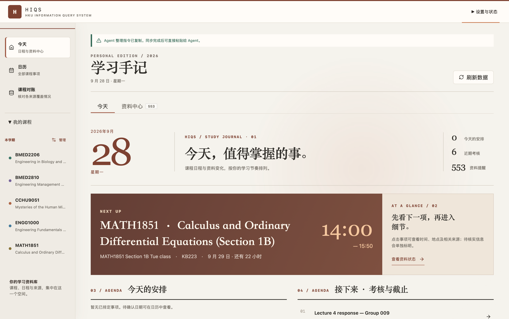
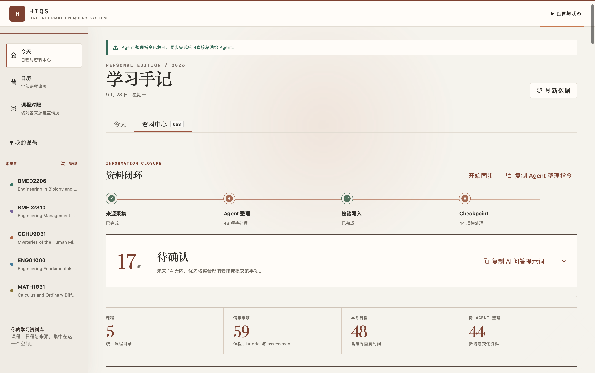
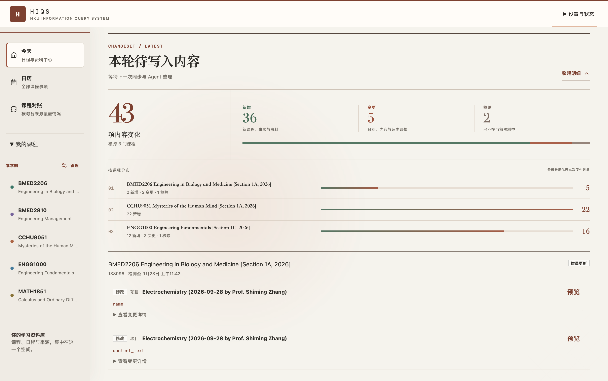
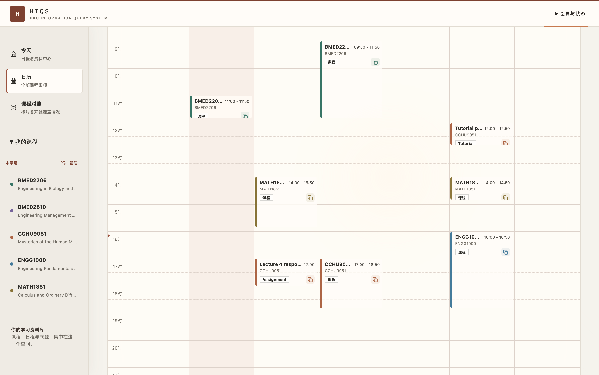
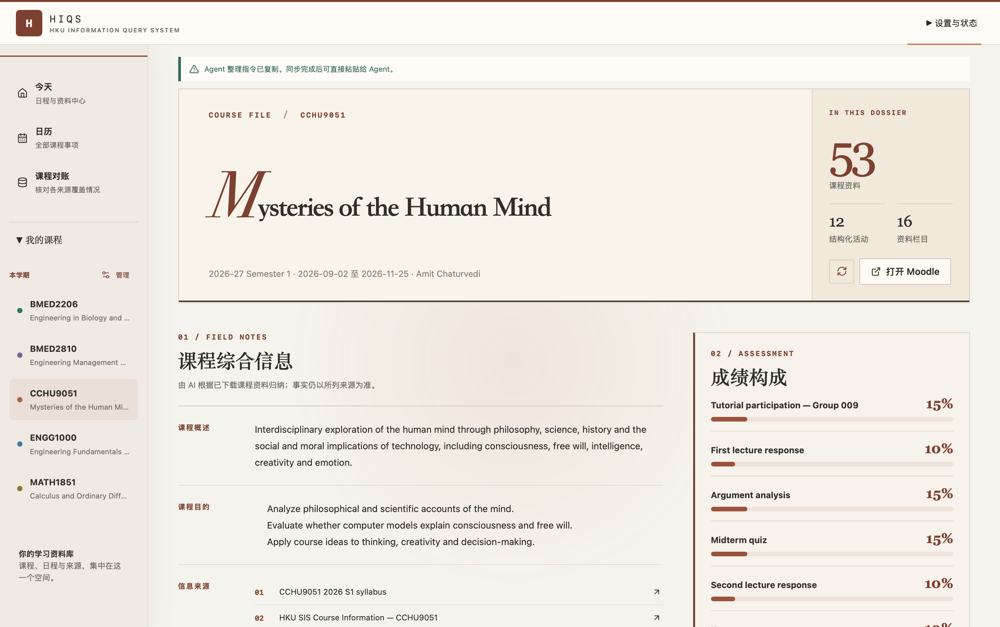
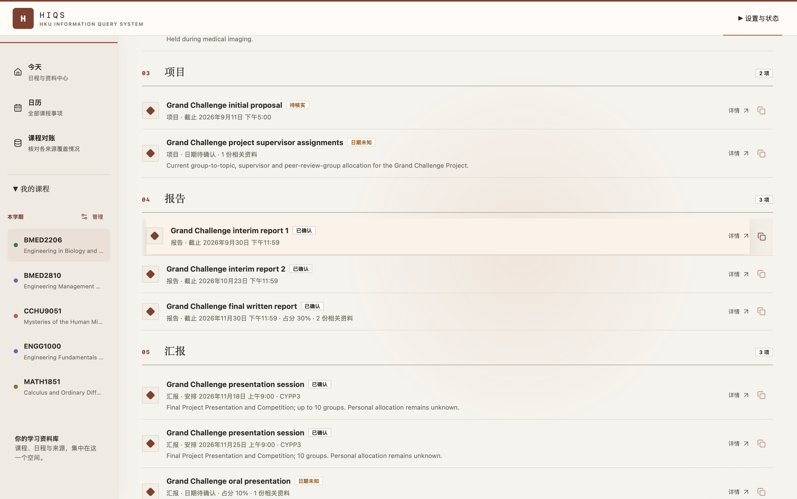

# 本地兼容界面

HIQS 的主要使用方式是 Agent Skills 配合 Notion。以下是保留的本地
React Dashboard／macOS 窗口功能与截图，供旧安装、连接未配置和恢复诊断使用。
截图展示本地兼容客户端，不代表 Notion 工作台布局。

配置 Notion 后，`hsas ui` 与 macOS 入口会打开该工作台；未配置时使用本地界面。
兼容客户端仍共享 `HIQSPort`，没有独立的课程事实或 AI 工作流。

## 界面展示

### 学习手记与今日安排

### 资料闭环

### 本轮资料变化

### 跨课程周日历

### 课程概览与成绩构成

### 课程活动与确切要求

## 界面功能

### 首页

- 查看今天的课程、下一项安排、近期考核与资料更新。
- 查看 Agent 最近一次整理后新增的活动与资料，以及哪些活动的信息发生变化或由未知、暂定状态得到确认；字段级差异仍保留用于核对来源。
- 在“需要确认”中优先处理最多三项近期问题，并可查看事项、证据或精确重试来源。
- 一键同步课程来源，并查看进度、失败项目和待整理资料。
- 搜索本地课程信息和课件。
- 复制 Agent 整理指令，处理本轮新增或变化的内容。
- 添加、移除和管理课程。

### 日历

- 在月、周、日视图中集中查看所有课程和活动。
- 按课程或关键字筛选，并查看日期、地点、占分、提交方式和要求。
- 在事项详情中查看证据确认状态、处理方式、来源、警告与当前限制。
- 显示假期、Reading Week、补课、取消、改时与教室变更。
- 保留日期尚未确认的活动，方便之后继续核对。
- 添加个人事项，或导出为 ICS 日历文件。

### 课程概览

- 查看课程简介、学习目标、教师、教学日期和成绩构成。
- 在课件与活动之间切换，快速找到 Assignment、Quiz、Project、Exam 及相关 DDL。
- 从活动卡直接复制 Agent 提示词，查询要求、来源和相关课件。

### 课件与来源

- 按课程自身的周次、主题或学习用途浏览完整课件。
- 搜索 PDF、DOCX、PPTX 文本以及 Moodle 页面正文；Text and media area 的表格会保留
  行列、空单元格和合并关系供 Agent 阅读。
- 对 Moodle 活动页中的同源嵌套链接做有界深度递归采集；中间页面正文、来源和深度会进入
  活动证据，链接指向的文件会进入该活动的文件清单和文本索引。
- 预览 PDF、图片、DOCX 和 PPTX 的内容，并打开原文件或 Moodle 来源。
- 从课件卡复制定位提示词，让 Agent 查询资料、核对来源并定位页码或 slide。
- 对照当前注册课程、Moodle 和其他官方资料，找出缺项与待确认信息。

